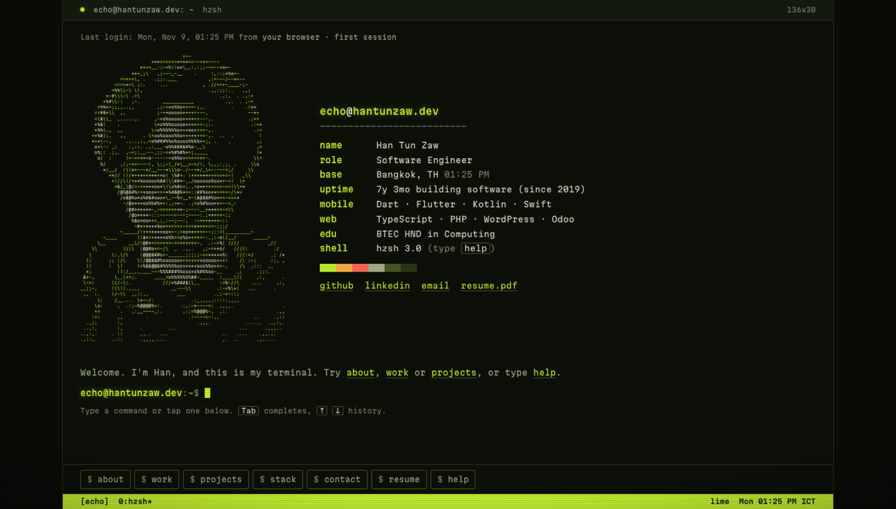
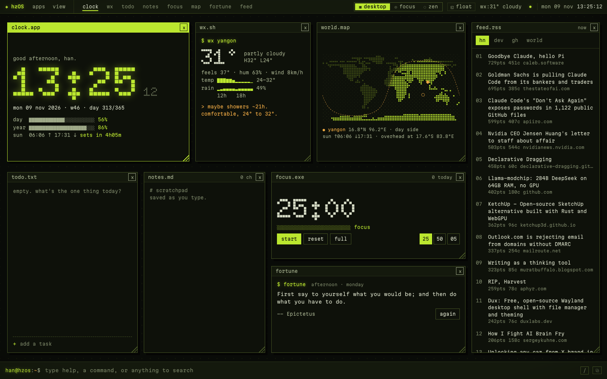

<div align="center">

# `echo@hantunzaw.dev:~$`

**A portfolio you log into, and a browser home page that thinks it's an operating system.**

[**Open the terminal →**](https://www.hantunzaw.dev/) &nbsp;·&nbsp; [**Boot hzOS →**](https://www.hantunzaw.dev/home/) &nbsp;·&nbsp; [Résumé](Resume-HanTunZaw.pdf)




</div>

---

## What's in here

Two small apps, both plain HTML, CSS and JavaScript with no framework or bundler.

### 1. `hzsh`, the portfolio terminal (`/`)

My portfolio as a terminal session. It boots with a short log, shows an ASCII portrait next to a neofetch-style card, and then you're at the prompt.

- **Real shell feel:** Tab completion, ↑/↓ history, aliases (`cv`, `skills`, `ll`…), and a "did you mean `work`?" for typos like `wrok`.
- **Content as commands:** `about`, `work`, `projects`, `stack`, `education`, `contact`, `resume`. On mobile you can tap the chips under the prompt instead of typing.
- **Toys:** `neofetch`, `matrix`, `hack`, `theme amber|ice|purple`, `sudo` (no), `rm -rf /` (also no), `vim` (good luck).
- **`hzos`** (or `startx`) shuts the terminal down like a CRT and hands the session over to hzOS.

### 2. `hzOS`, my browser home page (`/home/`)



A home page I actually use every day, built as a tiny desktop OS with windows you can drag, resize, maximize, or pin to float above the tiled grid.

| app | what it does |
|---|---|
| `clock.app` | Dot-matrix clock, day and year progress, sunrise and sunset countdown |
| `wx.sh` | Weather with 12-hour temperature and rain sparklines ([Open-Meteo](https://open-meteo.com/)) |
| `world.map` | Dot-matrix world map with a live day/night line and the point where the sun is overhead |
| `todo.txt` / `notes.md` | Local tasks and a scratchpad that saves as you type |
| `focus.exe` | Pomodoro timer with a chime and a count of today's sessions |
| `fortune` | Quotes matched to the time of day and day of the week (`@friday @evening`) |
| `feed.rss` | Hacker News, DEV, trending GitHub repos and Wikipedia news |
| `viz.app` | Three.js audio visualizer driven by your mic or shared tab audio |
| `game.exe` | Snake, a typing test, and *bughunt*, a small raycasting shooter |

Plus **desktop / focus / zen modes**, five WCAG AA themes, and a command line with 60+ commands (`= 2^10/4`, `timer 10m tea`, `define`, `wiki`, `cowsay`, `pass`…).
The full manual is in [`home/README.md`](home/README.md).

### 3. The 404 page is a honeypot 🍯

Scanners always try `/.env`, `/wp-admin` and `/.git/config`. Here they get obviously fake "secrets" and a hacker meter that gets cheekier with each attempt. Nothing is logged or sent anywhere. GitHub Pages has no server, and the point is a laugh, not surveillance.

---

## How it's built

- **No build step.** Every file in this repo is served exactly as written. ES modules, CSS custom properties for theming, `localStorage` for state.
- **Locked down for a static site.** A strict Content-Security-Policy with a hashed inline script, no third-party scripts, and `connect-src 'self'` on the portfolio.
- **Accessible on purpose.** `prefers-reduced-motion` skips the boot animation and CRT effects, the portrait has a text description, and a `<noscript>` fallback still shows every link.
- **Lazy where it counts.** Three.js (vendored, r170) loads only when you open `viz.app`. Map coastlines are cached after the first load.
- **The ASCII portrait** is generated from a photo by [`assets/ascii/make_portrait.py`](assets/ascii/make_portrait.py).

```text
.
├── index.html            # hzsh, the portfolio terminal
├── 404.html              # the honeypot
├── assets/
│   ├── css/term.css
│   ├── js/term.js        # shell: commands, completion, history, hzOS handoff
│   ├── js/eggs.js        # easter eggs shared by all three pages
│   ├── js/honeypot.js    # fake .env / wp-admin / .git responses
│   └── ascii/            # portrait generator
└── home/                 # hzOS
    ├── os.js, os.css     # window manager, modes, command line
    ├── data.js           # weather, feeds, settings, storage
    ├── quotes.js         # tag-matched quote picker
    ├── games.js, fps.js  # snake, typing test, raycaster
    ├── viz.js, map.js    # audio visualizer, world map
    └── classic/          # the older glass-dashboard version
```

## Run it locally

```bash
git clone https://github.com/hantunzawDev/hantunzawDev.github.io.git
cd hantunzawDev.github.io
python3 -m http.server 8080
```

Open http://localhost:8080 for the terminal, or http://localhost:8080/home/ for hzOS.
Any static server works. Weather, feeds and fonts need an internet connection.

---

## Want to use it? Go ahead 🙌

This project is **MIT licensed**. Fork it, clone it, and make it your own terminal or home page.

If you do, I'd really appreciate it if you:

1. ⭐ **Star this repo**, so I know it was useful
2. 🔗 **Link back** to [hantunzaw.dev](https://www.hantunzaw.dev/) somewhere on your version, for example in the footer, the `about` command or your README
3. 👋 **Show me what you made.** I'd love to see it.

You can reach me by:

- opening an [issue](https://github.com/hantunzawDev/hantunzawDev.github.io/issues/new?title=Built%20with%20hzOS%3A%20) titled **"Built with hzOS: \<your link\>"**
- email at **[dev.hantunzaw@gmail.com](mailto:dev.hantunzaw@gmail.com)**
- typing `contact` at [hantunzaw.dev](https://www.hantunzaw.dev/)

Please swap in your own name, portrait, résumé and links before publishing. The jokes you can keep. 😄

---

<div align="center">

**Han Tun Zaw** · Software Engineer · Bangkok
Flutter · mobile · full-stack since 2019

[GitHub](https://github.com/hantunzawDev) · [LinkedIn](https://www.linkedin.com/in/hantunzaw/) · [Email](mailto:dev.hantunzaw@gmail.com)

<sub>`echo@hantunzaw.dev:~$ exit`, thanks for reading.</sub>

</div>
